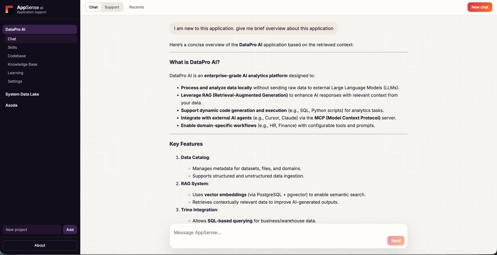
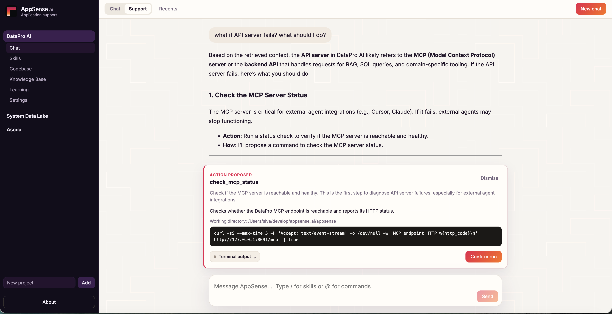
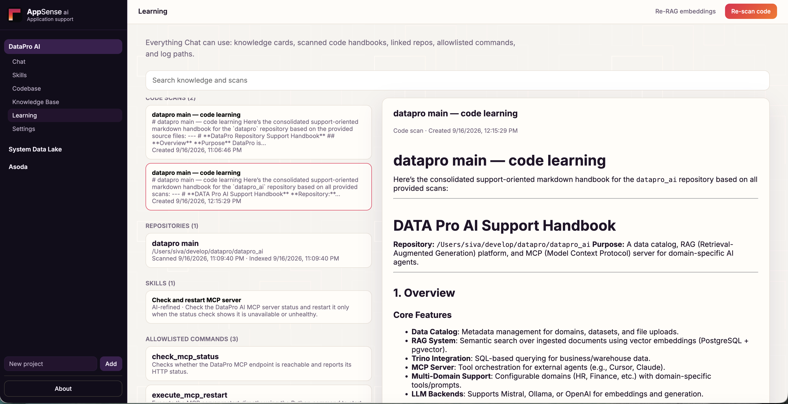
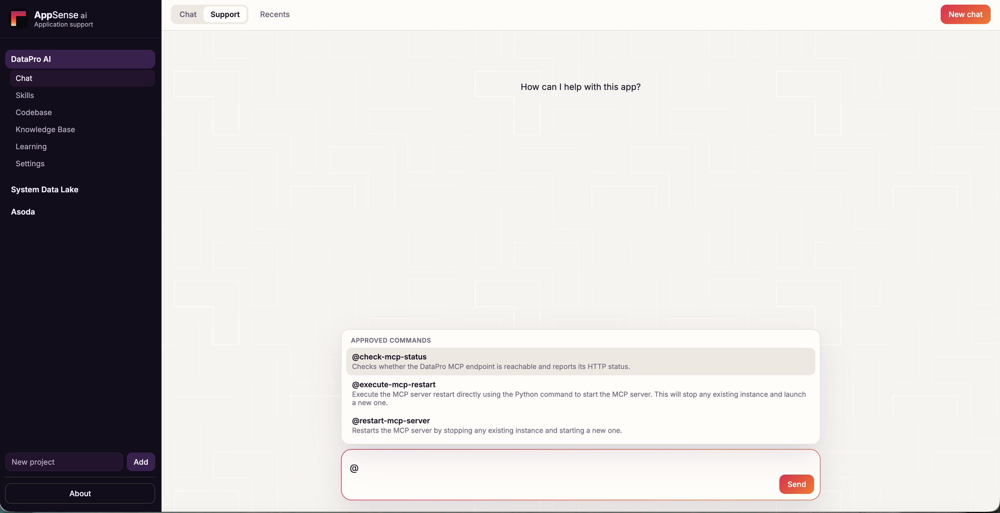

# AppSense

**The application that keeps learning with you.**

## Overview

AppSense is a local support companion for the teams who build, run, and evolve software. It learns the live application — code, scans, skills, and logs — and holds that picture like a thorough SME: how the system is built, how it runs, and how it fails.

You are **not dependent on users to create knowledge bases**. Link the codebase, scan it, and AppSense builds the understanding itself. Optional notes or uploads can enrich what it already knows; they are not a prerequisite for support or discovery.

It is built **predominantly for support teams**: so they can diagnose and fix issues with limited or no help from engineering. Instead of waiting for a developer or SME (or a wiki someone never finished), support can ask the app what is wrong, follow guided steps, check logs, and run confirmed playbook actions. The same living knowledge also helps development, architecture, and product — from first response through design and delivery.

> Knowledge remains. Always available.  
> If someone leaves tomorrow, the next person can still learn the app, diagnose it, and move it forward.

### Who it helps

| Team | How AppSense helps |
|------|--------------------|
| **Support** (primary) | Turn symptoms into diagnosis and resolution without paging engineering. Use Chat/Support, skills, logs, and allowlisted commands so L1/L2 can clear incidents and answer “how do I…?” with confidence. |
| **Development** | See how the app is wired, how it fails, and what ops already know before changing code — fewer “who owns this?” interruptions and clearer impact of a fix. |
| **Architecture** | Keep a living view of structure, integrations, and operational constraints from scans and knowledge — useful for reviews, refactors, and “what breaks if we change X?” |
| **Product** | Understand capabilities, limits, and run-time behavior without waiting for a walkthrough — so roadmap and prioritization stay grounded in how the system actually works. |

Across the lifecycle: **support resolves today** (symptoms → logs → steps → confirm); **dev, architecture, and product move tomorrow** with shared context instead of tribal knowledge.

### Benefits

- **Support independence** — Diagnose and fix with limited or no technical-team involvement; escalate only when the playbook truly needs engineering.
- **No SME bottleneck** — Incidents and questions go to the app’s living knowledge, not a waiting list for “the right person.”
- **No KB project required** — Behaves like a thorough SME from the application itself; teams do not need to author and maintain a separate knowledge base to get value.
- **Faster onboarding** — New joiners on support, eng, or product learn architecture, operations, and playbooks without a knowledge-transfer meeting.
- **Living context** — Code scans, optional docs, skills, and logs stay in one place and adapt as the application changes.
- **Safer operations** — Support mode can propose allowlisted commands; nothing runs until a person confirms.
- **One companion across roles** — Support, developers, architects, product owners, ops, QA, and partners share the same picture of the app.

---

## How it works

AppSense adopts the app instead of waiting for a handbook.

```text
Code Base → Scan → Knowledge → Skills → Chat / Support
```

1. **Link a codebase** — Point at a local folder or Git URL under Code Base.
2. **Scan** — Generates a readable handbook of how the app is wired and how it runs.
3. **Optional knowledge** — Write or upload notes if you want; useful extras, not a required wiki. The scan and code already carry the core understanding.
4. **Capture skills** — Describe playbooks when they are useful (for example `/nightly-settlement-check` in Support).
5. **Chat or Support** — Ask questions over RAG (knowledge, code, skills). Chat is information-only; Support can invoke skills and propose allowlisted commands with human confirmation.

| Mode | What it does |
|------|----------------|
| **Chat** | Information only. How it works, what a log means, what you *could* do. No operational actions. |
| **Support** | Skills via `/`, allowlisted commands, step-by-step resolution. Actions still wait for you. |

**Human in the loop.** AppSense may propose the next step. It does not run free-form shell. Allowlisted commands execute only after a person confirms.

### What’s in the app

- **Chat / Support** — RAG over knowledge, code, and skills  
- **Learning** — Inventory of notes, scans, skills, commands, and logs  
- **Skills** — Playbooks you can refine with AI  
- **Code Base** — Link a local folder or Git URL, then Scan  
- **Knowledge** — Write or upload; it stays in the project  
- **Settings** — LLM, embeddings, log paths, allowlisted commands, delete project  
- **About** — Full presentation ([PDF](frontend/public/about/appsense-presentation.pdf))  

Stack: FastAPI backend, React + Vite frontend, SQLite + Chroma for metadata and RAG, OpenAI-compatible LLM (Mistral by default).

---

## Demo

Point AppSense at **your** codebase (no bundled sample app):

1. Start the app (see below).
2. Create a project in the UI.
3. Under **Code Base**, link a local folder or Git URL, then **Scan**.
4. Optionally add knowledge, skills, log paths, and allowlisted commands.
5. Use **Chat** or **Support** to ask questions and walk through resolution.

### Chat — learn the application

Ask for an overview; AppSense answers from scanned code and knowledge.



### Support — diagnose and act

In Support mode, AppSense can propose allowlisted steps (for example a health check) and wait for you to confirm before running.



### Learning — what the companion knows

Learning shows code scans, linked repos, skills, and allowlisted commands — everything Chat and Support can use.



### Skills and commands in Support

Type `/` for skills or `@` for approved commands to drive guided resolution.



Presentation slides: [appsense-presentation.pdf](frontend/public/about/appsense-presentation.pdf) (also available from **About** in the app).

---

## Prerequisites

| Requirement | Notes |
|-------------|--------|
| **Python 3.11+** | Backend (3.12 recommended) |
| **Node.js 18+** and npm | Frontend |
| **LLM API key** | Mistral (or any OpenAI-compatible provider) for chat and embeddings |
| **Git** (optional) | Needed if you link remote repositories |
| **Docker** (optional) | For running AppSense with Docker Compose |

---

## Deployment and how to run

### Configure environment

From this folder (`appsense/`):

```bash
cp .env.sample .env
# Put your Mistral (or other OpenAI-compatible) API key in .env
```

| Variable | Purpose |
|----------|---------|
| `LLM_BASE_URL` | OpenAI-compatible API (default `https://api.mistral.ai/v1`) |
| `LLM_API_KEY` | Secret key for chat and embeddings |
| `LLM_MODEL` | e.g. `open-mistral-nemo` |
| `EMBEDDING_MODEL` | e.g. `mistral-embed` |
| `CHROMA_PATH` / `SQLITE_PATH` | Local RAG + metadata (defaults under `./data`) |
| `UPLOADS_PATH` / `REPOS_PATH` | Uploaded files and cloned repos |

**Do not commit `.env`.**

### Option A — Docker Compose (recommended)

Requires [Docker](https://docs.docker.com/get-docker/) and Compose (`docker compose` or `docker-compose`).

```bash
# from appsense/
docker compose up --build
# or: docker-compose up --build
```

- UI: [http://127.0.0.1:5173](http://127.0.0.1:5173) (nginx proxies `/api` to the backend)
- API on the host: [http://127.0.0.1:8000](http://127.0.0.1:8000) (loopback only)
- Data persists in `./data` on the host; `.env` is mounted into the backend

Set `FRONTEND_PORT` in `.env` to change the UI port. The default is `5173`.

### Option C — Single EC2 instance

One Amazon Linux instance runs the same Compose file. Browsers use `http://<elastic-ip>` on port 80. The API stays on the instance loopback and is reached through nginx.

1. Attach `docs/aws-iam/appsense-sandbox-deployer-policy.json` to the IAM user or role that will run the deploy.
2. From this folder, with AWS credentials and a public subnet:

```bash
cp .env.sample .env   # set LLM_API_KEY
SUBNET_ID=subnet-xxxxxxxx BUCKET=appsense-deploy ./deploy/ec2/deploy.sh
```

The bucket name must start with `appsense-`. The script creates it if needed (with the tags required by the deployer policy), launches stack `appsense-ec2`, and starts the containers. Re-run the same command to ship a new build to the existing instance.

Optional: `ALLOWED_CIDR=203.0.113.0/24` limits who can open the site. `INSTANCE_TYPE` defaults to `t4g.medium`.

SQLite, Chroma, and uploads live on the instance disk under `/opt/appsense/data`. Replacing or terminating the instance removes that disk. There is no login on the app; the security group is the access control. Use Session Manager rather than SSH. The instance role is `docs/aws-iam/appsense-task-role-policy.json` (S3 for the deploy bundle, plus Session Manager).

Useful commands:

```bash
docker compose up --build -d    # detached
docker compose logs -f          # follow logs
docker compose down             # stop containers
```

### Option B — Run locally without Docker

**Backend** (from `backend/`):

```bash
python3 -m venv .venv
source .venv/bin/activate   # Windows: .venv\Scripts\activate
pip install -r requirements.txt
uvicorn app.main:app --reload --host 127.0.0.1 --port 8000
```

Health check:

```bash
curl -sS -i --max-time 5 http://127.0.0.1:8000/api/health
```

**Frontend** (second terminal, from `frontend/`):

```bash
npm install
npm run dev
```

Open [http://127.0.0.1:5173](http://127.0.0.1:5173). Vite proxies `/api` to the backend.

### Production-style frontend build (without Compose)

```bash
cd frontend
npm run build
npm run preview
```

Serve the API with Uvicorn (or a process manager) on port `8000`, and point the built UI at that API (or keep the same proxy pattern you use in development). Data stays on disk under `data/` unless you change the paths in `.env`.

---

## License

Use and extend for your own application support. Keep secrets in `.env`, never in git.

Project story and broader context also live in the [root README](../README.md).
